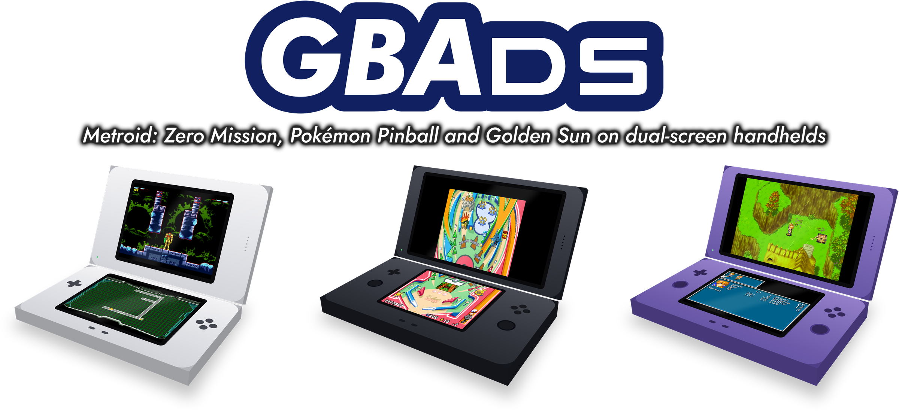

# GBA DS

[English](README.md) · **中文**

> 本文是英文 [README](README.md) 的完整翻译，内容以英文版为准（英文版更新更快）。本仓库是 GBA DS 的中文分支 `zh-cn`，中文界面的细节见下面「中文界面（本分支）」一节；“关于 AI 的说明”一段是原作者 kyannon 以第一人称写的。

<p align="center"></p>

面向双屏掌机的 Game Boy Advance 模拟器（为 Anbernic RG DS Plus 而做，支持 ROCKNIX，以及 GammaOS 上的 Android）。游戏在一块屏幕上运行，游戏自己的地图留在另一块屏幕上，并随着你探索实时保持最新——就像 NDS 上的《恶魔城》那样。

这里的出发点是“如果 Game Boy Advance 有第二块屏幕会怎样”。至少目前，两块屏幕都不当作触摸屏使用；第二块屏幕的用法更接近 NDS《恶魔城》：显示地图或其他辅助信息，让有空间容纳它的设备玩起来更舒服一些。（整个项目源于把 NDS 上的《恶魔城》全玩了一遍之后，又想到要退回 GBA 时代，难免有点难过……）

<p>


</p>

<sub>上下叠放的屏幕、像素精确缩放、开启 LCD 网格。</sub>

GBA DS 支持 56 款游戏（含各区域版本和其中一些改版）：完整列表以及每款游戏在副屏上显示什么，见 wiki 的[支持的游戏](https://github.com/kyannon/gba-ds/wiki/Supported-games)。其他任何 GBA 游戏也能运行，只是只在单屏上玩。改版和其他补丁（`.ips`、`.ups`、`.bps`、`.xdelta`）可以在暂停菜单（Extras → Patches）里为每个游戏分别开启。

**文档都在 [wiki](https://github.com/kyannon/gba-ds/wiki) 里：** [游玩](https://github.com/kyannon/gba-ds/wiki/Playing) · [支持的游戏](https://github.com/kyannon/gba-ds/wiki/Supported-games) · [覆盖层](https://github.com/kyannon/gba-ds/wiki/Overlays) · [设置](https://github.com/kyannon/gba-ds/wiki/Settings) · [疑难解答](https://github.com/kyannon/gba-ds/wiki/Troubleshooting) · [为游戏添加副屏支持](https://github.com/kyannon/gba-ds/wiki/Adding-second-screen-compatibility-for-a-game) · [理念](https://github.com/kyannon/gba-ds/wiki/Philosophy)

## 中文界面（本分支）

本分支 `zh-cn` 是带中文界面的 GBA DS（简体中文，以及供台湾、香港、澳门使用的繁體中文）。游戏列表、设置、暂停菜单、快捷栏、金手指、补丁、覆盖层、热键、按键映射、更新，以及程序自己的各种提示都是中文；在**设置 > 游戏 > 语言**里选择语言：自动（跟随系统，系统不是中文就用英文）、English、中文（简体）或中文（繁體）。切换即时生效，选 English 则与原版完全一致。

中文使用 Noto Sans SC 和 Noto Sans TC（SIL Open Font License 1.1，位于 `assets/fonts/`），按界面实际用字做了裁剪；中文段落按字断行。成就名称和说明来自 RetroAchievements，游戏名和路径是你自己的数据，这些保持英文原样。**文本和字体是怎么做的，见 [docs/I18N.md](docs/I18N.md)。** 本 README 其余部分、wiki 和发行包都来自上游项目。

## 工作原理

模拟核心是 [libmgba](https://mgba.io)。GBA DS 在真正的模拟器旁边再跑一份安静的副本。大约每秒一次（`gba-ds.cfg` 里的 `map_interval`），以及在每次切换房间之后（以画面淡出到黑来判定），它做这几件事：

1. 把正在运行的游戏状态复制进那份安静的副本。你正在玩的游戏从不暂停，也不被触碰。
2. 在副本里按下地图键，等地图画面出现并稳定，然后录一小段帧循环，让闪烁或脉动的玩家标记仍然有动画。
3. 显示之前用两种方式校验结果：一个只有地图画面打开时才置位的内存标志，以及地图画面边框或背景上的固定像素。标题画面、过场、菜单和淡入淡出都会被拒绝，仍然显示上一张地图。

你看到的是游戏自己画出的真实地图，细节一样不少（已探索的房间、存档与传送房间、完成度、区域名），以 4 倍整数倍缩放。《月轮》的地图画面没有完成度，所以 GBA DS 会把游戏暂停画面里 “RATE” 后面的百分比复制到地图右上角——即使城堡 100% 探索，那里也不会压到房间（右下角作为备选）。

没有地图的游戏用别的方式使用副屏：

- **《马力欧卡丁车：超级赛道》** 每帧画两遍：一遍不带 HUD，给游戏屏幕；一遍只带 HUD（金币、圈数、时间、前四名、赛道地图），给副屏，这样 HUD 后面的东西一点也不会丢。道具框和名次会被放回游戏屏幕的角落，赛道地图则以两倍大小画在压暗的赛道背景图上。
- **《托尼·霍克职业滑板 2》** 在游戏显示当前这一轮的目标清单时，把它复制到副屏，并在你滑行期间一直留在那里。

在还没有东西可显示之前，副屏显示游戏徽标——第一次在列表里出现某个游戏时，从 ROM 里在后台提取出来。

## 安装

从[发行页](https://github.com/kyannon/gba-ds/releases)下载最新版本，然后按你的系统看对应指南：

- **[ROCKNIX](https://github.com/kyannon/gba-ds/wiki/Install-on-ROCKNIX)**（原版 ROCKNIX 或 ROCKNIXDS）：把 `gba-ds-v…-linux-aarch64.zip` 解压到 `/storage/roms/ports/`，然后从 Ports 启动 **GBA DS**。指南里也讲了 Ports 图标、从 EmulationStation 的 Game Boy Advance 列表启动游戏，以及升级。
- **[BananaOS](https://github.com/kyannon/gba-ds/wiki/Install-on-BananaOS)**：同一个 zip，解压到卡的 `roms/ports`；游戏放在 `roms/gba`。
- **[Stock Linux OS](https://github.com/kyannon/gba-ds/wiki/Install-on-Stock-Linux-OS)**（RG DS Plus 自带的系统，实验性）：同一个 zip，解压到卡的 `Ports` 文件夹；游戏放在 `Roms/GBA`。
- **[Android](https://github.com/kyannon/gba-ds/wiki/Install-on-Android)**（GammaOS）：安装 `gba-ds-v…-android.apk`，允许“所有文件访问权限”，把 ROM 放进 `ROMs/gba`。要从 GammaOS、Daijisho、ES-DE 或其他前端启动游戏，见[从 Android 前端启动](https://github.com/kyannon/gba-ds/wiki/Launching-from-Android-frontends)。
- **[在浏览器里玩](https://kyannon.github.io/gba-ds/)**（beta）：选一个 GBA 游戏，在电脑、平板或手机上带着副屏玩，什么都不用装。游戏和存档都留在你的设备上。

## 编译

在 x86_64 Linux 主机上（需要 git、cmake、make 和 zip）执行：

```sh
scripts/build-rocknix.sh            # -> dist/gba-ds-v<VERSION>-linux-aarch64.zip
```

脚本会把 GCC aarch64 工具链、mGBA（固定提交）和 SDL2 取到 `deps/`。

`-dev` 版本（VERSION 带 `-dev`）还会带上 `gba-ds/web/gba-ds.wasm`，即由 `scripts/build-web.sh` 编译成 WebAssembly 的 GBA DS（需要 clang、wasm-ld、llvm-ar、cmake 和 git，以及 `deps/` 里由 `scripts/setup-host.sh` 或 `scripts/build-rocknix.sh` 准备好的 mGBA 和 SDL2 源码；第一次会顺带编译 binaryen 的 `wasm-opt`）。把这样的 zip 拖到 State Saver 工具（`tools/statesaver/`）的 GBA DS 标签页上，就能在浏览器里以默认设置跑这份构建、看两块屏幕，在装到设备上之前先测。

要在主机上编译以便开发和测试（另需 libpng-dev）：

```sh
scripts/setup-host.sh   # 第一次：把 mGBA 和 SDL2 取到 deps/，然后编译
make && make tools      # 之后：build/host/gba-ds、build/host/harness
```

Android 应用 `scripts/build-android.sh`（-> `dist/gba-ds-v<VERSION>-android.apk`）需要 Android SDK 和 NDK，所以放在 GitHub Actions 上跑（`.github/workflows/android.yml`；APK 在运行结果的 artifacts 里）。网页版播放器 `scripts/build-web-player.sh`（-> `build/web-player/`）会把 web 构建打包成一个能在浏览器里打开的页面；GitHub Pages 从 `main` 发布它。

无界面运行，并用脚本驱动它（按键组合、`HOME`、`TAP:x,y`、`SHOT:file.bmp`、`QUIT`；见 `--help`）：

```sh
SDL_VIDEODRIVER=offscreen SDL_AUDIODRIVER=dummy GBADS_WINDOW=640x960 \
  build/host/gba-ds --rom-dir=roms --state-dir=/tmp/st --input-script=test.txt
```

要为另一款游戏添加副屏支持，见[为游戏添加副屏支持](https://github.com/kyannon/gba-ds/wiki/Adding-second-screen-compatibility-for-a-game)；副屏上该放什么，见[理念](https://github.com/kyannon/gba-ds/wiki/Philosophy)。

## 关于 AI 的说明

GBA DS 几乎完全由 AI 写成。代码由 Anthropic 的 AI 模型 Claude 在 Claude Code 会话中编写，文档、更新日志和提交信息也是如此。要做什么、应该是什么行为由我决定，并且由我测试。

**一次改动是怎么来的**

1. **我提出需求**，比如新增一款游戏、修一个 bug，或者改变某个东西的外观和手感。我通常会附上存档状态、截图或设备的照片来说明我的意思。
2. **Claude 写改动**，并在交给我之前先在桌面构建上自测。GBA DS 可以无界面运行，并从存档状态回放脚本化的按键，所以 Claude 会把两块屏幕截图下来看过，再发给我。对新增的游戏，它还会用一个逐帧驱动模拟器、读取游戏内存的测试工具。
3. **每个构建我都真机测试。** 设备是一台 Anbernic RG DS Plus，跑 ROCKNIX 和 Android（GammaOS）。在我在设备上玩过、确认它能用、并且原来能用的仍然能用之前，任何东西都不会进发行版。出问题的时候，我会把照片或截图发回去，再来一轮。有些改动要来回好几轮才对。
4. **发行由我决定。** 版本什么时候算好、每次 GitHub 发行都由我来定。ROCKNIX 的 zip 从发布代码的一份全新副本构建。Android 的 APK 由 GitHub Actions 构建并签名，不在任何人的电脑上做。

**你从提交历史里能看到的：** 自 2026 年 10 月 16 日起，每次提交都显示 “kyannon authored and Claude committed”，并带 Verified 标记。“authored” 表示我提出并认可了这个改动，“committed” 表示由 Claude 写。更早的提交只显示我，但做法是一样的。

**哪些不是 AI 生成的：** 游戏徽标和副屏画面是在程序运行时从你自己的 ROM 里提取的，不是 AI 画的，也不随程序一起分发。模拟本身是 [mGBA](https://mgba.io) 的——一个长期存在、由人编写的模拟器，GBA DS 建立在它之上。

**这对你意味着什么：** 我无法保证没有 bug，但发行版里的每个功能都在它为之前做的设备上用过。无法在我的硬件上测试的功能会标注为*实验性*（例如从某些 Android 前端启动游戏）。如果某个东西对你不起作用，请[开一个 issue](https://github.com/kyannon/gba-ds/issues)；它同样会在硬件上被测试。

## 与任天堂无关

GBA DS 是一个独立项目，与任天堂、Anbernic、AYN、Retroid 或其他设备厂商没有关联，也未获其认可或赞助。Game Boy Advance、Nintendo DS 以及各游戏名称是其各自所有者的商标，此处仅用于说明 GBA DS 能运行什么。图片展示的是在 GBA DS 中运行的游戏；图中的掌机是通用示意图，不是真实产品。

GBA DS 不包含游戏、BIOS 文件或其他受版权保护的游戏数据。请使用你自己合法获得的游戏副本。

## 许可

GBA DS 是自由软件：你可以依据自由软件基金会发布的 [GNU 通用公共许可证](LICENSE) 第 3 版重新分发和／或修改它。分发它是希望它有用，但不提供任何担保，也不含对适销性或特定用途适用性的默示担保。详见 [GNU 通用公共许可证](LICENSE)。

GBA DS 中由他人完成的部分保留各自的许可，均与 GPL 兼容：

GBA DS 静态链接 libmgba，版权所有 © Jeffrey Pfau，以 MPL-2.0 授权。mGBA 源码见 <https://github.com/mgba-emu/mgba>（固定提交记录在 `scripts/mgba-options.sh`）。

界面文字使用 [Jost](https://github.com/indestructible-type/Jost)（© The Jost Project Authors），以 SIL Open Font License 1.1 打包（`assets/fonts/Jost-OFL.txt`），并用 [stb_truetype](https://github.com/nothings/stb)（公共领域）绘制。中文界面另用 Noto Sans SC 和 Noto Sans TC（© The Noto Project Authors，同样是 SIL Open Font License 1.1，见 `assets/fonts/NotoSansSC-OFL.txt`、`NotoSansTC-OFL.txt`）。

RetroAchievements 支持使用 [rcheevos](https://github.com/RetroAchievements/rcheevos)（© RetroAchievements，MIT 许可），放在 `third_party/rcheevos`。WebP 徽标用 [libwebp](https://github.com/webmproject/libwebp) 的解码器读取（© Google Inc.，BSD 许可），放在 `third_party/libwebp`。
